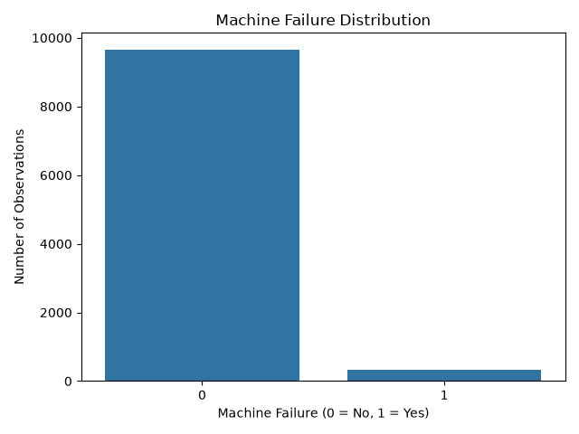
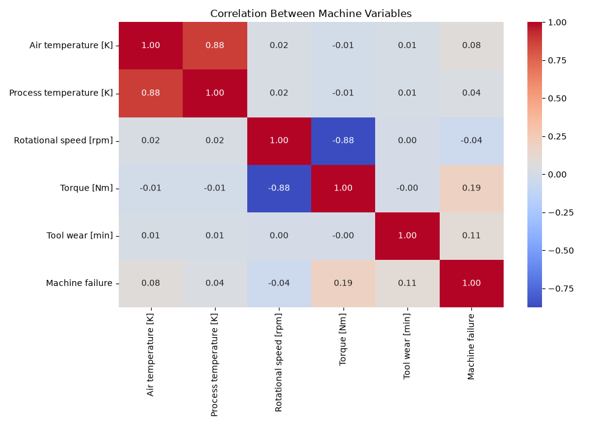
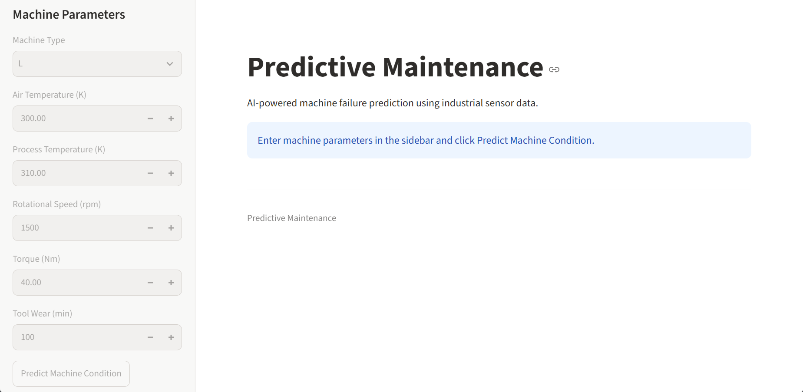

# Predictive Maintenance System

## Overview

This project develops a machine learning-based predictive maintenance system to identify potential machine failures using industrial sensor data.

## Problem Statement

Unexpected machine failures can disrupt production and increase operational costs.

This project explores how machine learning can support predictive maintenance through sensor data.

## Dataset

AI4I 2020 Predictive Maintenance Dataset.

Source:
https://archive.ics.uci.edu/dataset/601/

## Technologies

- Python
- Pandas
- NumPy
- Scikit-learn
- Random Forest
- Streamlit
- Matplotlib
- Seaborn

## Methodology

1. Data Collection
2. Exploratory Data Analysis
3. Data Preprocessing
4. Model Development
5. Model Evaluation
6. Dashboard Development

## Machine Learning Model

Random Forest Classifier

## Evaluation Metrics

- Accuracy
- Precision
- Recall
- F1-score
- ROC-AUC
- PR-AUC

## Results
- failure distribution

- correlation matrix

- Model Metrics
```json
{
    "accuracy": 0.9785,
    "precision": 0.711864406779661,
    "recall": 0.6176470588235294,
    "f1_score": 0.6614173228346457,
    "roc_auc": 0.9674255571793935,
    "pr_auc": 0.7306090209501508
}
```

## Application



## How to Run

Install dependencies:

pip install -r requirements.txt

Train the model:

python src/train.py

Run the dashboard:

streamlit run app.py

## Limitations

This project uses a public educational dataset.
Predictions are not a substitute for actual
industrial inspection.

## Author
Nabilah Robbaniyah — Informatics Student